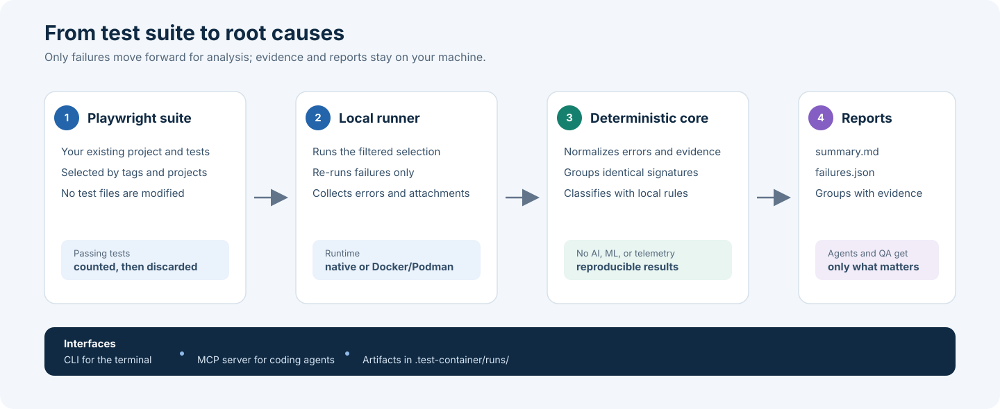

# test-container

**Local, deterministic triage of Playwright failures, with compact results for
QA engineers and coding agents.**

`test-container` runs the tests that match your tags, re-runs the failures, and
groups what still fails by root-cause signature so you read a handful of groups
instead of hundreds of stack traces. Classification is rule-based and happens
on your machine: no model calls, no external services, no telemetry. Playwright
still runs your tests. This project is unrelated to Testcontainers.



## What it does

- **Selects by tag.** `--tags @smoke,@checkout` with `any` or `all` matching,
  plus optional `--grep`, `--grep-invert`, and `--project` filters.
- **Runs natively or in a container.** The `docker` runtime uses the official
  Playwright image that matches your installed version, so browsers and system
  libraries are identical on every machine. Your host `node_modules` is never
  modified.
- **Re-runs failures.** Failed tests are re-run with a configurable backoff to
  separate transient failures from stable ones. Tests tagged `@no-rerun` are
  never repeated.
- **Classifies and groups.** Each failure is labelled `BUG`, `LOCATOR`,
  `ENVIRONMENT`, `TRANSIENT`, `TEST_ISSUE`, `KNOWN_ISSUE`, or `INCONCLUSIVE`,
  with a reason and a confidence score, then grouped by signature. Add your own
  rules and known issues to tune the results.
- **Suggests locators.** When a locator stops matching, the page's ARIA
  snapshot is scanned for a unique replacement. Suggestions are never applied
  automatically.
- **Writes compact reports.** A short `summary.md`, one file per group,
  `failures.json`, logs, and Playwright traces under `.test-container/runs/`.
- **Speaks MCP.** An MCP server exposes runs, summaries, groups, and failures to
  coding agents over stdio.

## Getting started

Requirements: Bun 1.4.4, Node.js 22 or newer, and a project with
`@playwright/test` installed. Docker or Podman is optional.
Node.js remains supported for CLI execution and is used by the existing
Vitest and build tooling.

Install the dependencies and build the CLI from a checkout of this repository:

```sh
bun install --frozen-lockfile
bun run build
```

Run the demo suite from the checkout root:

```sh
bun run cli run --tags @demo --runtime native --project-root examples/demo-tests --wait
```

The output looks like this (abridged):

```text
run 20261111-120010-4858 done 0m | tags any(@demo) | proj all | pw 1.65.0 native
tests 7 | passed 2 | failed 5 | groups 6 | skipped 0
G1 BUG 1 c0.65 bug.assertion-value tests/triage.spec.ts:9
G5 ENVIRONMENT 1 c0.90 env.network tests/triage.spec.ts:13
G6 TRANSIENT 1 c0.95 transient.passed-on-rerun tests/triage.spec.ts:25
files: .test-container/runs/20261111-120010-4858/
```

To use your own suite, run `init --write` in the project folder and point the
CLI at it with `--project-root`:

```sh
bun run cli run --tags @regression --project chromium --env ENV=qa --project-root ../my-tests --wait
```

## Runtimes

| Runtime  | Behavior                                                                                                                                |
| -------- | --------------------------------------------------------------------------------------------------------------------------------------- |
| `native` | Runs Playwright with the CLI's JavaScript runtime (Bun or Node.js) and browsers installed on the host.                                  |
| `docker` | Runs Playwright in `mcr.microsoft.com/playwright:v<version>-noble`. Dependencies are installed from your lockfile into a cached volume. |
| `auto`   | Uses `docker` when the engine is running, otherwise `native`. This is the default.                                                      |

With the `docker` runtime, test selection still runs on the host, so the
project needs its dependencies installed locally. The project folder is mounted
at `/work`, and `node_modules` comes from a named volume
(`tc-node-modules-<hash>`) with a cached dependency installation.
Environment values passed with `--env` reach the container by name, not on the
command line. Configure the engine in `test-container.config.yml`:

```yaml
version: 1
runtime: docker
docker:
  engine: docker # or podman
  image: auto # or a pinned image
  pull: if-missing # always | if-missing | never
  extraArgs: ["--ipc=host"]
  hostGateway: true # adds host.docker.internal
```

The JavaScript runtime is separate from `--runtime`, which selects the
execution location. `bun run cli` uses Bun for the CLI, runner, and Playwright
workers. To use Node.js instead, run the same built CLI with
`node packages/cli/dist/index.js`. Both can read existing run reports.

Docker runs launched with Bun cache the matching Bun version in the dependency
volume. For dependency installation, an explicit `packageManager` takes
precedence; otherwise `bun.lock` (or legacy `bun.lockb`) takes precedence over
other lockfiles. Bun installs use a pinned version and `--frozen-lockfile`.
The dependency cache is invalidated by manifest, lockfile, image, or installer
changes. Child processes do not auto-load Bun `.env` files; see
[Environment and secrets](#environment-and-secrets) for the supported ways to
pass variables.

## Environment and secrets

Test processes receive an allowlisted environment, not your whole shell
environment. Variables reach them from three sources. When a name appears in
more than one, the later source in this list wins:

1. `env.envFile`: a dotenv-style file, resolved from the project root.
   Variables with secret-looking names are skipped.
2. `env.passthrough`: names of variables to forward from the shell that starts
   the run. This is the only way to hand a secret to the tests.
3. `--env NAME=value`: a value for a single run. Names that look like secrets
   (for example `API_TOKEN` or `DB_PASSWORD`) are rejected, so secrets stay out
   of shell history and process lists. So are names that steer the tool or the
   process loader: `TC_*`, `PATH`, `NODE_OPTIONS`, `NODE_PATH`, `BUN_OPTIONS`,
   `LD_*`, `DYLD_*`, `DOCKER_*`, and a few system variables. These checks cover
   `--env` only, the one channel an MCP client can reach. The env file and
   `env.passthrough` come from your project.

```yaml
env:
  envFile: .env.qa
  passthrough: [API_TOKEN, BASE_URL]
```

The run state records the names of the forwarded variables, never their values,
so `summary --json` and the MCP tools cannot hand them to a client. For the same
reason `rerun-group` does not remember `--env` values: pass them again when you
re-run a group.

When a run finishes, the runner redacts the values of secret-named variables
from the JSON, Markdown, HTML, log, and text files in the run folder. It also
redacts `Authorization` and `Cookie` header values, passwords inside URLs, bare
JSON web tokens, and `password=...`, `token: ...`, and `?api_key=...` style
pairs. Values shorter than six characters are only caught by those patterns,
never replaced everywhere, so a short value such as `30` cannot corrupt a
report.

Redaction is best effort and works by name and by pattern. A name counts as
secret-looking when it matches `redaction.namePattern`, which by default covers
whole name parts such as `pass`, `secret`, `token`, `key`, `auth`, `cookie`,
and `session`, so `API_KEY` counts but `AUTHOR` and `KEYCLOAK_URL` do not. A
secret held in a variable with an ordinary name is not recognized unless you
extend the pattern. Playwright trace archives are kept as Playwright wrote them
and can contain anything your tests print or capture. Treat `.test-container/`
as sensitive and do not share it.

## Trust model

A run executes your project's Playwright configuration and test code, which is
arbitrary code, so point `test-container` only at projects you trust, as you
would with `playwright test`. The `docker` runtime gives you reproducible
browsers and libraries; it is not a sandbox. The project folder is mounted
read-write, the container runs as the image's default user, and the default
`--ipc=host` argument shares the host's IPC namespace. `docker.extraArgs` is
passed to the container engine exactly as the project's configuration lists it.

The MCP server serves one project folder, chosen by whoever starts it with
`mcp --project-root <path>` (the current directory by default). Clients cannot
point it at another folder, but a client that can call `start_run` can run that
project's tests. See the [security policy](SECURITY.md) for the details.

## Commands

| Command                                        | Purpose                                                                                                                                                               |
| ---------------------------------------------- | --------------------------------------------------------------------------------------------------------------------------------------------------------------------- |
| `init [--write]`                               | Show or create `test-container.config.yml`, rules, and known issues.                                                                                                  |
| `doctor`                                       | Check Node.js, Playwright, the run store, and the container engine.                                                                                                   |
| `run --tags @a,@b [options]`                   | Start a run. Options: `--match any\|all`, `--grep`, `--grep-invert`, `--project`, `--workers`, `--rerun`, `--runtime`, `--env NAME=value`, `--wait`, `--timeout min`. |
| `wait [run_id] [--timeout min]`                | Wait for a run to finish. The wait stops after 300 minutes by default.                                                                                                |
| `summary [run_id] [--json]`                    | Print the compact summary.                                                                                                                                            |
| `group <id> [run_id]`                          | Show one group with its tests, evidence, and suggestion.                                                                                                              |
| `failure <test> [run_id]`                      | Show one failure.                                                                                                                                                     |
| `rerun-group <id> [run_id] [--env NAME=value]` | Run only the tests of one group again.                                                                                                                                |
| `runs [--limit n]`                             | List recent runs.                                                                                                                                                     |
| `cancel [run_id]`                              | Stop a run and remove its containers.                                                                                                                                 |
| `clean [--keep n]`                             | Prune old runs.                                                                                                                                                       |
| `mcp`                                          | Start the MCP server on stdio, bound to one project folder.                                                                                                           |

Every command accepts `--project-root <path>` after the command name to act on a
project other than the current directory. `--timeout` limits how long the CLI
waits, not how long the run lasts, and only applies with `--wait` and `wait`.
Exit codes are `0` when a run finishes (failed tests are in the summary, not in
the code), `2` for usage or configuration errors, `3` when the container engine
or Playwright is missing, and `4` when a run errors, is cancelled, or is still
going when the wait ends. See the [CLI reference](docs/cli.md).

Run artifacts live in `.test-container/runs/<run_id>/` inside the tested
project. That folder ignores itself in Git.

## Principles

- **Local-first:** results and evidence stay in your project.
- **Deterministic:** explainable local rules; no AI calls or telemetry.
- **Failures only:** passing tests appear only in the counts.
- **Suggestions, not edits:** test code is never changed automatically.
- **Incremental adoption:** your existing Playwright setup keeps running the
  tests.

## Development

```sh
bun run check
bun run build
```

Use `bun run test` for the Vitest suite, not Bun's separate `bun test` runner.
CI checks both Bun and Node.js execution, including a browser smoke test.

See the [architecture overview](docs/architecture.md), the
[classification guide](docs/classification.md), the
[CLI reference](docs/cli.md), the [contributing guide](CONTRIBUTING.md), and
the [security policy](SECURITY.md).

## License

Apache-2.0. See [LICENSE](LICENSE).
